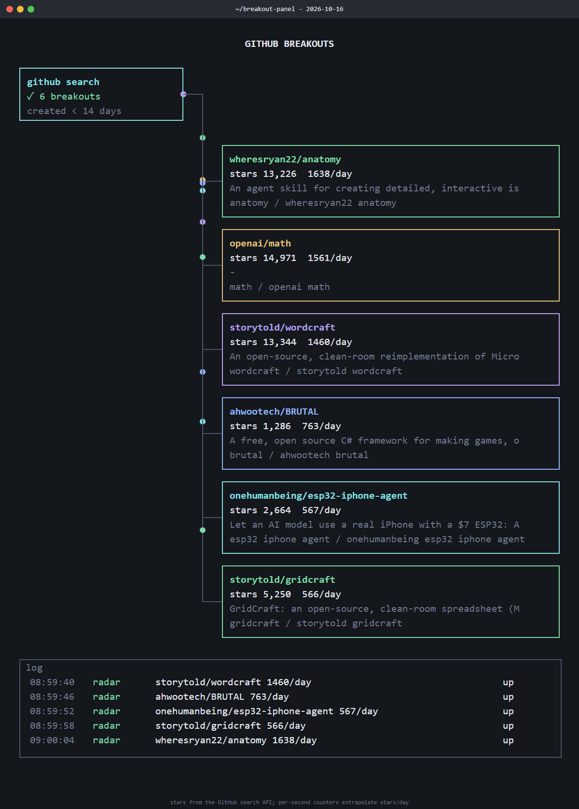

<div align="center">

# breakout-panel

**Turn today's fastest-rising GitHub repos into an animated live-panel page in one command.**

The breakout signal from [new-term-radar](https://github.com/zhuyansen/new-term-radar) meets the terminal-style animated diagrams of [live-panel](https://github.com/ythx-101/live-panel-skill): one Python file, no dependencies.

Works with **Claude Code** and **Codex**.

 

</div>

## Quick start
```bash
git clone https://github.com/Dodai0419/breakout-panel && cd breakout-panel
python breakout_panel.py --demo        # offline fixture; drop --demo for live GitHub data
```
```
  1638/day   13,226  wheresryan22/anatomy
  1561/day   14,971  openai/math
  1460/day   13,344  storytold/wordcraft
   763/day    1,286  ahwootech/BRUTAL
wrote breakout-panel.html
```
Open `breakout-panel.html` in any browser: packets flow from the search box to each repo, star counters tick at each repo's stars/day rate, and a log scrolls.



## The problem
- Spotting a breakout repo means scrolling GitHub search and doing stars-per-day math by hand.
- A list of numbers is a bad social post; animated diagram tools need a hand-written config, and video export needs Chrome + ffmpeg.
- The radar that does the math fetches owner names one request at a time, so a first run takes 12+ seconds.

## The solution
| Idea | Fixes |
|------|-------|
| **new-term-radar's breakout score** (stars/day since birth, or +N since the last snapshot), same thresholds | Finds the repos taking off, plus the search variants people type ("niko strata") |
| **Breakouts become a live-panel config** | Each repo is a box with a live star counter and a packet flow; no config to write |
| **Compact live-panel renderer** (text, box, line, flow, log; counter + lane machines) | A self-contained 8 KB page instead of 149 KB; renders upstream's `minimal` example too |
| **Parallel search pages and owner lookups** | 5.6 s instead of 12.5 s on a first run |

Render any live-panel config that uses the supported subset:
```bash
python breakout_panel.py --config fixtures/minimal.json --out minimal.html
```
In the page, `?t=5` opens at second 5 and `?manual` stops the loop (handy for screenshots).

Keep a snapshot to catch late jumps (`+N since last run`): `python breakout_panel.py --state stars.json`. Set `GITHUB_TOKEN` to raise the API rate limit.

## Use with Claude Code
```bash
/plugin marketplace add Dodai0419/breakout-panel
/plugin install breakout-panel@breakout-panel
```

## Use with Codex (ChatGPT)
```bash
git clone https://github.com/Dodai0419/breakout-panel && cp -r breakout-panel/skills/* ~/.codex/skills/
```
Or copy `AGENTS.md` into your project root.

## Benchmarks
| | original | this repo |
|-|-|-|
| live breakout run, fresh state (2 search pages + 15 owner lookups) | 12.5 s (new-term-radar `breakout.breakouts`; runs: 12.74, 12.54) | 5.6 s (runs: 5.32, 5.70, 5.86) |
| page build + write, live-panel `examples/minimal/config.json` | 11.8 ms (`livepanel.build_page`; median of 5 rounds of 50) | 2.5 ms (`render` + write; median of 5 rounds of 50) |
| page size, same config | 148,756 bytes | 8,449 bytes |
| lines of code | 131 (breakout.py + snap.py) + 630 (livepanel.py + template.html), plus 2,082 in views/*.js | 222 in total |
| dependencies | stdlib (+ Chrome and ffmpeg for mp4) | stdlib |

Windows 11, Python 3.11.1, authenticated GitHub API. Network times depend on GitHub latency. Upstream fetches owner names only for repos it has not flagged before, so its later runs make fewer calls; the table compares first runs.

Not supported yet: live-panel's `loop`/`ring`/`funnel` views, `path`, `tarrow`, the `cycle`/`gauge`/`triggers` machines, the light-pastel theme and mp4 export. Unsupported elements are skipped with a console warning.

## Inspired by
- [zhuyansen/new-term-radar](https://github.com/zhuyansen/new-term-radar) — the breakout score and search-variant logic (MIT).
- [ythx-101/live-panel-skill](https://github.com/ythx-101/live-panel-skill) — the JSON config format and terminal-dark look (MIT).

## Roadmap
- [ ] `path` elements and the `cycle` machine
- [ ] Optional mp4 export through headless Chrome
- [ ] A daily GitHub Action that publishes the panel to Pages

## License
MIT

## Related tools
- [hf-newcomers](https://github.com/Dodai0419/hf-newcomers): models and Spaces that just entered Hugging Face trending
- [session-panel](https://github.com/Dodai0419/session-panel): replay a Claude Code session as an animated panel
- All tools, one install pattern: [github.com/Dodai0419](https://github.com/Dodai0419)
